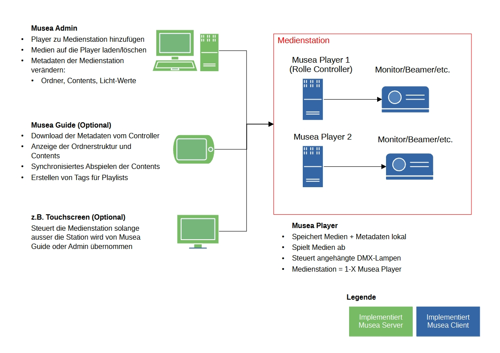

# Technische Dokumentation

## Wichtige Begriffe und Datenstruktur
**Medienstation**: Gruppe von Musea Playern, die synchronisiert Medien abspielen

**Controller**: Musea Player, der die Datenstruktur speichert  

**Content**: Medieninhalt, der auf Playern abgespielt wird  

→ [Vollständige Liste und Datenstruktur](../general/data-structure.md)

## Gesamtarchitektur
Die Softwarelösung besteht aus drei Apps, die über das Netzwerk kommunizieren:

- **[Musea Player](https://github.com/enniomariani/Musea-Player)**: Spielt Medien ab und steuert DMX-Lichter.
- **[Musea Admin](https://github.com/enniomariani/Musea-Admin)**: Kombiniert Musea Player zu Medienstationen, erstellt Ordner, Contents und fügt Medien hinzu.
- **[Musea Guide](https://github.com/enniomariani/Musea-Guide)**: Spielt Medien synchron ab, gruppiert Contents mit Tags zu Playlisten.

**npm Pakete**
- **[musea-client](https://github.com/enniomariani/Musea-Client)**   - Medien auf den Servern verwalten, synchronisieren, löschen und abspielen
- **[musea-server](https://github.com/enniomariani/Musea-Server)**   - Server der Medien-Player: Speichert/löscht Medien, sendet DMX-Signale an angehängte Lampen

## Kompatibilität verschiedener Versionen
Nur Apps mit derselben Major-Version (z.B. 2.X.Y) sind kompatibel.

Die Versions-Nummern der Apps orientieren sich an der [semantischen Versionierung](https://semver.org/).

## Netzwerk & Kommunikation

**Verbindungsrollen**

| App | Rolle | Gleichzeitige Verbindungen |
|-----|-------|---------------------------|
| **Musea Player** | Server | 1× Admin + 1× User |
| **Musea Guide/Admin** | Client (Admin) | Exklusiv pro Player |
| **Touchscreen für Besucher:innen** | Client (User) | Wird bei Admin-Zugriff blockiert |

**Netzwerkprotokoll**

- [eigenes Protokoll](network-protocol.md) über WebSockets
- Implementiert in `musea-client` und `musea-server`

## Testabdeckung
  - **Unit Tests**: Jest
  - **E2E Tests**: WebdriverIO für User-Flows in Guide/Admin
  - **Manuelle Tests**: DMX-Hardware, große Files (>1GB), Zusammenspiel der Apps

## Musea Player Rollen
- **Default:** Empfängt Medien und Befehle
- **Controller:** Wie Default + speichert zusätzlich Datenstruktur (contents.json)
