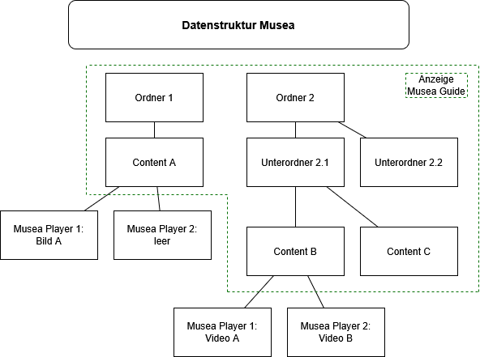

# Wichtige Begriffe und Datenstruktur

## Wichtige Begriffe

| Begriff            | Bedeutung                                                                                                        |
|--------------------|------------------------------------------------------------------------------------------------------------------|
| **Medien**         | Videos oder Bilder (später evtl. mehr).                                                                          |
| **Content**        | Ein «Inhalt», der aus einem oder mehreren Medien besteht. Benutzer:innen wählen nur Contents aus.                |
| **Musea Player**   | Programm das Medien abspielt.                                                                                    |
| **Musea Admin**    | Programm zur Verwaltung der Musea Player über das Netzwerk. Hier werden Contents erstellt und Medien zugewiesen. |
| **Medienstation**  | Mehrere in Musea Admin zusammengehängte Musea Player.                                                            |
| **Musea Guide**    | App zur Steuerung der Medienstationen.                                                                           |
| **Controller-App** | Musea Player mit «Controller»-Rolle, speichert die «contents»-Datei (Metainformationen zu den Contents).         |

## Aufbau der Datenstruktur

**Ordner**
- Können beliebig viele Unterordner enthalten
- Dienen zur Organisation von Contents

**Inhalte (Contents)**
- Liegen in Ordnern
- Enthalten Medien für einen oder mehrere Player
- Jedem Player kann pro Content genau ein Medium zugewiesen werden

**Medien**
- Videos, Bilder
- Werden spezifischen Playern zugewiesen
- Können gemischt werden (Player 1: Video, Player 2: Bild)

💡 **Beispiel**: Ein Content "Gemälde XY" kann auf Player 1 ein Detailbild zeigen, 
während Player 2 ein Erklärvideo abspielt.

---

## Verwaltung

**Musea Admin**
- Erstellt und verwaltet diese Struktur
- Speichert sie auf dem Musea Player mit der Rolle "Controller"

**Musea Guide**
- Lädt die Struktur vom Controller
- Sendet play/pause/etc. Befehle an Musea Player

